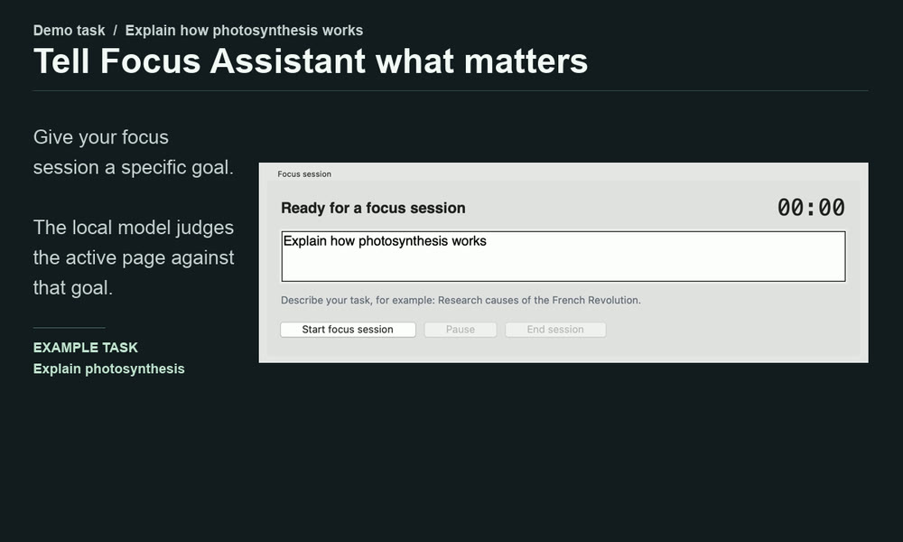
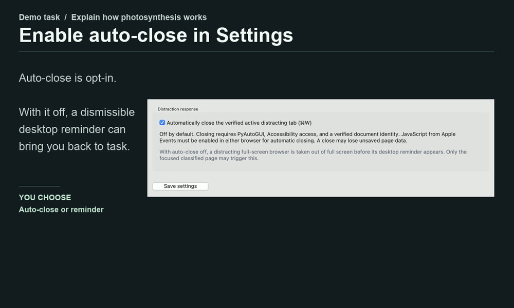
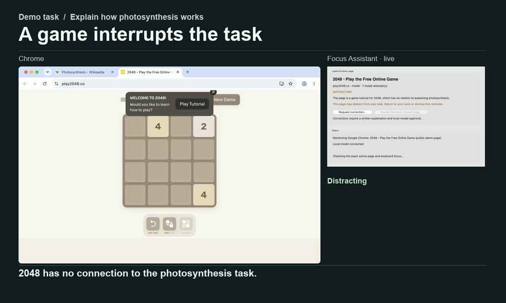
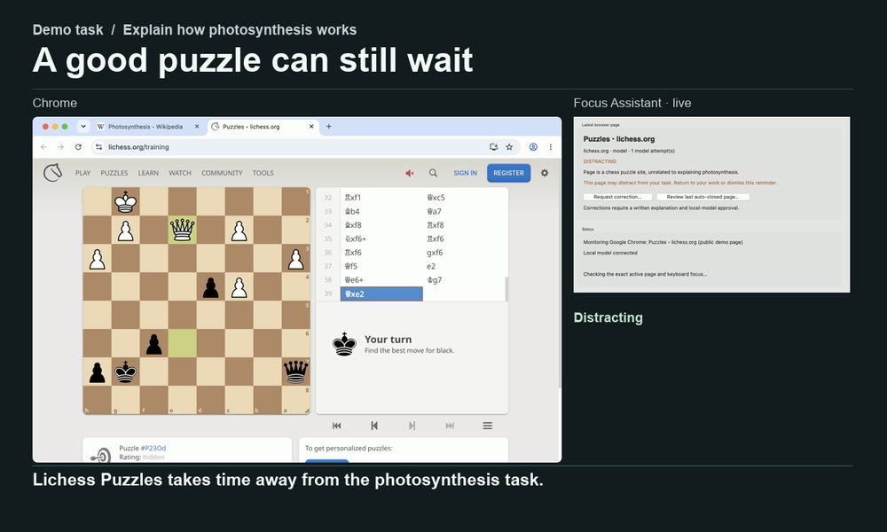
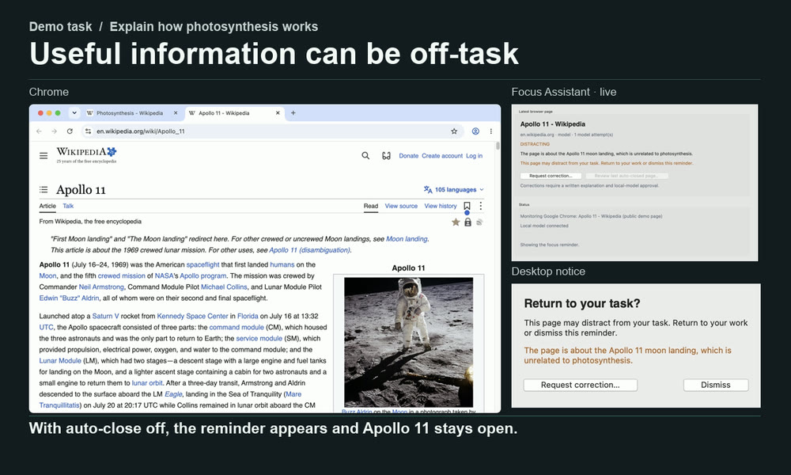
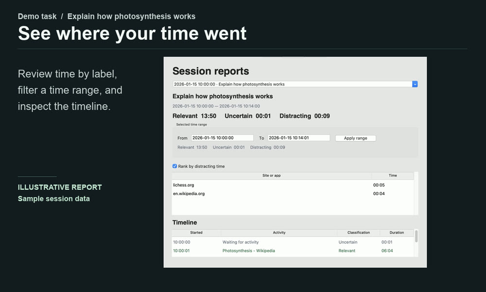

# Focus Assistant

**Close distracting tabs. Keep your task in view.**

https://github.com/user-attachments/assets/73dd71d9-f30a-4e41-a2d8-06ef686cce64

[Animated preview](docs/media/focus-assistant-demo.gif) · [Download the captioned MP4](https://github.com/error-404-userNotFound/FocusAssistant2.1/raw/refs/heads/main/docs/media/focus-assistant-demo.mp4) · [Install Focus Assistant for macOS](#installation)

Focus Assistant is an extension-free macOS app for **Safari and Chrome**. Set a
goal for your session and let a local model classify the active browser tab as
relevant, distracting, or uncertain. With auto-close enabled, the app sends
**⌘W** after rechecking that the same classified tab is still active and focused.
Once it verifies the close, it shows a dismissible notice naming the tab and
explaining the classification.

## See the features in action

<table>
<tr>
<td width="42%"><strong>Set a goal for your session</strong><br>Describe what you’re working on, such as “Explain how photosynthesis works.” Pause or resume whenever you need to.</td>
<td width="58%"><a href="docs/media/start-a-focus-session.jpg"></a></td>
</tr>
<tr>
<td><strong>Choose how the app responds</strong><br>Auto-close is off by default. Enable it in Settings to close distracting tabs during a focus session.</td>
<td><a href="docs/media/choose-a-response.jpg"></a></td>
</tr>
<tr>
<td><strong>Close the verified active tab</strong><br>In the demo, the app closes the loaded 2048 game and a Lichess puzzle with ⌘W. The Photosynthesis tab stays open.</td>
<td><a href="docs/media/close-2048.jpg"></a><br><a href="docs/media/close-lichess.jpg"></a></td>
</tr>
<tr>
<td><strong>See what closed and why</strong><br>Once a tab close is verified, the desktop notice names the tab and shows the model’s reason. Dismiss it or request a correction directly from the notice.</td>
<td><a href="docs/media/auto-close-notice.jpg"></a></td>
</tr>
<tr>
<td><strong>Judge the page against your task</strong><br>Apollo 11 is unrelated to photosynthesis. Reading an unrelated article can still reduce productivity, even when it’s educational. In the demo, the local model marks the Photosynthesis article as relevant and Apollo 11 as distracting.</td>
<td><a href="docs/media/classify-by-task.jpg"></a></td>
</tr>
<tr>
<td><strong>Keep the tab open with a reminder</strong><br>With auto-close off, a dismissible reminder appears. If the verified distracting tab is in full screen, the app exits full screen before showing the reminder.</td>
<td><a href="docs/media/desktop-reminder.jpg"></a></td>
</tr>
<tr>
<td><strong>Review how you spent your time</strong><br>See session totals by classification, filter a time range, and inspect the timeline of browser and application activity.</td>
<td><a href="docs/media/review-a-session.jpg"></a></td>
</tr>
</table>

The app also supports local domain and keyword rules, caches task-specific
decisions, and retries uncertain model responses up to three times with more
context. To request a correction, submit a written explanation for the local
model to review.

<details>
<summary>Recording details and credits</summary>

The demo uses a sample task, a temporary signed-out Chrome profile, and Qwen 3.5
4B running locally through LM Studio. Focus Assistant’s classifier and guarded
⌘W action ran on the live pages. The recording harness used Chrome DevTools to
limit page observation and tab verification to that profile. The installed app
uses macOS Apple Events for browser access. Chrome, the live dashboard and the
desktop notices were captured separately and arranged side by side. Timing was
edited, and the report uses illustrative session data.

Pages shown include [2048](https://play2048.co/), [Lichess Puzzles](https://lichess.org/training),
[Photosynthesis](https://en.wikipedia.org/wiki/Photosynthesis), and
[Apollo 11](https://en.wikipedia.org/wiki/Apollo_11). Wikipedia excerpts and
the [photosynthesis diagram by At09kg, Wattcle, and Nefronus](https://commons.wikimedia.org/wiki/File:Photosynthesis_en.svg)
appear in cropped, captioned screen recordings under
[CC BY-SA 4.0](https://creativecommons.org/licenses/by-sa/4.0/).
The [Apollo 11 photograph](https://commons.wikimedia.org/wiki/File:Buzz_Aldrin_by_Neil_Armstrong.jpg)
is by Neil Armstrong for NASA.

</details>

Keyboard shortcuts cannot atomically lock focus to a tab. Model decisions can
be wrong, and closing a tab may lose unsaved data. Read
[behavior and safety](docs/BEHAVIOR.md) and [verification limits](CHECKS.md) before
enabling automatic closing.

## Requirements

- macOS with a supported **Python 3.11+ installation including Tk** for source use.
  Apple Silicon and Intel are targeted; the CI matrix covers both architectures.
- Safari or Google Chrome. Other browser families are not yet supported.
- A local OpenAI-compatible chat-completions server, such as LM Studio, with an
  appropriate text model loaded. Model/server availability and performance depend
  on your hardware; neither is bundled with the app.
- Internet access during dependency installation. Normal classification requests
  go only to the configured loopback server.

The [python.org macOS installers](https://www.python.org/downloads/macos/) include
Tk; see [Python's macOS/Tk guidance](https://www.python.org/download/mac/tcltk/).
A system Python or package-manager Python may have a different Tk installation.

## Installation

### Easier installation: preview app downloads

The current source includes the verified-close desktop notice shown in the demo.
To use that feature now, follow the [source installation steps](#install-from-the-source-checkout).

Download a ZIP from the [2.1.0 preview release](https://github.com/error-404-userNotFound/FocusAssistant2.1/releases/tag/v2.1.0):

| Your Mac | Download |
|---|---|
| Apple Silicon (M-series chip) | `FocusAssistant-2.1.0-arm64.zip` |
| Intel processor | `FocusAssistant-2.1.0-x86_64.zip` |

Extract the ZIP, drag **Focus Assistant.app** into Applications, and open it.
Python and the app's dependencies are bundled; do **not** run Setup for this
installation method. You still need a local model server and the permissions
below.

These experimental builds target macOS 15 or later and are ad-hoc signed, **not
Apple-notarized**. macOS may block the first launch. Inspect the project and use
Apple's normal approval process only if you trust the download; never disable
Gatekeeper globally. Older macOS versions are not verified for the preview ZIPs.
Each ZIP has a companion `.sha256` file; put both in one folder and run
`shasum -a 256 -c <downloaded-name>.zip.sha256` to verify its checksum.

### Install from the source checkout

Download this repository as a ZIP and extract it, or clone it. Open Terminal in
the extracted project folder and run:

```sh
/bin/zsh Setup.command
/bin/zsh 'Launch Focus Assistant.command'
```

You can also double-click those scripts in Finder when executable permissions
are preserved. Setup creates **only a project-local `.venv`**, checks Python/Tk,
installs declared dependencies, and prints a local diagnostic report. It does not
use sudo, grant permissions, install models or send browser input.

After setup, these commands are equivalent:

```sh
.venv/bin/python run.py
.venv/bin/python -m focusassistant
```

For a specific Python, set `FOCUSASSISTANT_PYTHON` when running Setup. The launcher
normally uses `.venv`; its interpreter override is intended for development.
If you move the checkout, recreate `.venv` with Setup rather than copying a
virtual environment from another computer.

## First session and permissions

1. Start your local model server and load a text instruction model.
2. In **Settings**, check `http://127.0.0.1:1234/v1` (or your local server's URL),
   select the available model, and save. Only loopback addresses are accepted.
3. Start a focus session and switch to Safari or Chrome. Grant browser
   **Automation** access when macOS requests it.
4. Grant **Accessibility** to the actual launcher/app under System Settings →
   Privacy & Security for native focus checks, full-screen exit and keyboard
   control. Source and bundled launches may have different permission entries.
5. For Chrome text extraction, enable View → Developer → **Allow JavaScript from
   Apple Events**. Safari can read native text without it, but **automatic closing
   requires JavaScript automation in either browser** to verify document identity.

Screen Recording is not needed. The app never changes these settings itself.
Without sufficient access, the status explains why an observation/action was
refused. Missing identity or changed focus must not be replaced with a guessed
close target.

Auto-close is disabled by default. Configure rules if wanted, and initially try
warning-only mode with disposable pages. A model that spends all its output
budget on reasoning may need thinking disabled or a larger context configuration
in the server. Connection/model errors remain uncertain; they are not counted as
three valid semantic uncertainty responses.

The main app must keep running. Closing its main window ends the session and
quits. It is not an always-on background service.

## Connect a local model: LM Studio or Ollama

Focus Assistant uses **OpenAI-compatible** `/v1/models` and
`/v1/chat/completions` endpoints. It does not require an OpenAI account or a cloud
API key, and it rejects non-loopback server addresses.

| Local server | Base URL in Settings | Model field |
|---|---|---|
| LM Studio | `http://127.0.0.1:1234/v1` | Load **Qwen 3.5 4B** or **Gemma 4 E4B**, then select the exact ID returned by Check connection |
| Ollama | `http://127.0.0.1:11434/v1` | **`qwen3.5:4b`** or **`gemma4:e4b`** after downloading the chosen model |

**Recommended starting models for either server: Qwen 3.5 4B or Gemma 4 E4B.**
Choose a quantization that fits your Mac's memory and leave room for context and
other applications. These recommendations are starting points; the project does
not claim a measured classification accuracy for either model.

### LM Studio: graphical setup

1. Install [LM Studio](https://lmstudio.ai/). In its model discovery/search,
   look for **Qwen 3.5 4B** (`Qwen3.5-4B`) or
   **[Gemma 4 E4B](https://lmstudio.ai/models/google/gemma-4-e4b)**
   (`gemma-4-e4b`). Download a supported quantized version that fits your Mac's
   RAM. Use the exact loaded model ID shown by the server rather than assuming
   the display name is its API identifier.
2. Load the model and start its local server from the Developer section. Keep
   the server on loopback rather than exposing it to the network.
3. Enter `http://127.0.0.1:1234/v1` in Focus Assistant, click **Check connection**,
   choose the returned model ID, and **Save settings**.
4. If the server requires an API token, this version cannot supply one. Use a
   server configuration suitable for an unauthenticated loopback client, or use
   another supported local server. Do not paste credentials into a URL.

See [LM Studio's local-server documentation](https://lmstudio.ai/docs/developer/core/server)
and [OpenAI-compatible API documentation](https://lmstudio.ai/docs/developer/openai-compat).

### Ollama: a short CLI setup

Install [Ollama](https://ollama.com/download/mac) and launch the Ollama app, or
start its server with `ollama serve` if you are using the CLI without a running
server. Do not start a second server if the app is already serving port 11434.
Download either recommended model; choose one of these commands:

```sh
# Qwen 3.5 4B
ollama pull qwen3.5:4b

# Or Gemma 4 E4B
ollama pull gemma4:e4b
```

In Focus Assistant, enter `http://127.0.0.1:11434/v1`, check the connection, select
the model you downloaded—`qwen3.5:4b` or `gemma4:e4b`—and save. Use the `/v1`
OpenAI-compatible endpoint, not Ollama's separate `/api/chat` endpoint.
See the official [Qwen 3.5 4B](https://ollama.com/library/qwen3.5:4b) and
[Gemma 4 E4B](https://ollama.com/library/gemma4:e4b) model pages, and
[Ollama's OpenAI compatibility guide](https://docs.ollama.com/api/openai-compatibility).

### Model settings and troubleshooting

- Connection refused: start the server and check the port/base URL, including `/v1`.
- Empty model list: download/load a model; select its exact ID rather than an
  assumed display name. Other servers must implement both endpoints above.
- First request times out: a model may still be loading. Warm it in the server
  and retry. Requests have bounded timeouts and remain uncertain on failure.
- Truncated/malformed JSON: use an instruction model that follows JSON requests;
  disable lengthy reasoning/thinking in the server when necessary. The app allows
  2,048 response tokens, including reasoning counted by some servers.
- Later retries exceed context: configure sufficient context for up to 24,000
  page-text characters plus the task/instructions, or choose a suitable model.
- Use locally downloaded models for local inference. A local service that routes
  a cloud model remotely changes the privacy properties; that is controlled by
  the server, not prevented merely by a loopback connection.

Both server protocols are supported, but the regression HTTP fixtures do not
establish real-model accuracy or guarantee every model/server combination.

## Data and privacy

Default state: `~/Library/Application Support/FocusAssistant/state.json`.
This is separate from the earlier development copy. For an isolated store:

```sh
.venv/bin/python run.py --data-dir ./data
```

Tasks, page URLs/titles, labels, review reasons and activity records are stored
locally. Page bodies and recovery receipts stay in memory. There is no telemetry
or automatic upload. A local server can itself log/forward data; configure it
separately. See [PRIVACY.md](PRIVACY.md).

## Installation diagnostics

```sh
.venv/bin/python -m focusassistant --version
.venv/bin/python -m focusassistant --diagnose
```

Diagnostics checks imports/resources and permission status. It does not open a
focus session, read pages, request permissions or send keys. A false Accessibility
status means permission still needs to be granted, not that installation failed.
Review diagnostic output for private paths in error messages before sharing it.

## Standalone `.app` builds

The source checkout is ready for installation through Setup. A separate build
recipe produces a Python-bundled macOS app and ZIP:

```sh
/bin/zsh 'Build macOS App.command'
```

Build on each desired CPU architecture; an arm64 build is not automatically an
Intel build. The manual **Build macOS apps** GitHub workflow builds separate
Apple Silicon/Intel artifacts. It does not publish a release or change repository
visibility. Private-repository artifacts require repository access.

An ad-hoc/local build is **not Developer-ID signed and notarized**. Smooth public
binary distribution still requires signing, notarization and testing the stated
minimum OS/hardware configurations. See [distribution instructions](docs/DISTRIBUTION.md).
Never disable Gatekeeper globally to install this project.

## Development and verification

```sh
.venv/bin/python -m unittest discover -s tests -v
node tests/extraction_checks.cjs       # optional test-only Node dependency
.venv/bin/python -m tests.ui_smoke     # synthetic GUI check, no live controls
```

GitHub Actions runs core/extraction/package checks on Apple Silicon and Intel
macOS runners. Passing injected-interface tests does not establish live
close/reopen, multiple-Space behavior or model accuracy. See [CHECKS.md](CHECKS.md).

Architecture and the detailed correction/recovery safeguards are documented in
[docs/BEHAVIOR.md](docs/BEHAVIOR.md). For changes and contributions, see
[CHANGELOG.md](CHANGELOG.md) and [CONTRIBUTING.md](CONTRIBUTING.md).

## License

[MIT](LICENSE). Third-party Python packages and model weights retain their own
licenses. This repository does not include model weights or redistribute a local
model server.
