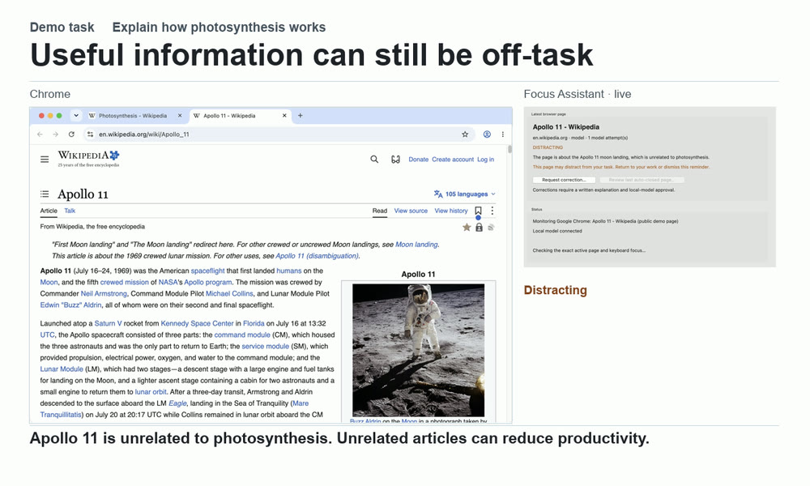
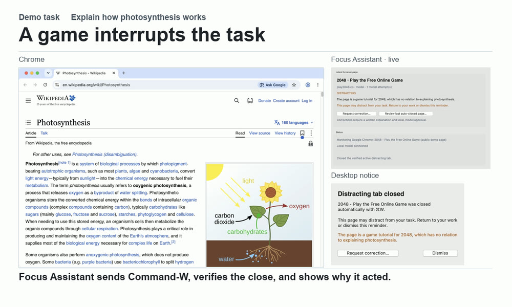

# Focus Assistant

A macOS app that helps you stay on task in Safari and Chrome without a browser extension. Tell it what you’re working on. A local model checks whether the active tab helps with that task, and you can turn on auto-close for distractions.

https://github.com/user-attachments/assets/902fb29e-66e5-4c64-bf41-6b4726be6063

[Download the macOS preview](https://github.com/error-404-userNotFound/FocusAssistant2.1/releases/tag/v2.1.0) or [view the animated demo](docs/media/focus-assistant-demo.gif).

## See the features in action

<table>
<tr>
<td width="46%"><strong>Context-dependent classification</strong><br>Say you’re studying photosynthesis. One Wikipedia article explains exactly what you need. Another takes you down an Apollo 11 rabbit hole. Both are useful articles, but reading the second takes time away from your work. A fixed allowlist or blocklist makes the same call when your task changes. Focus Assistant checks each page against what you’re doing right now.</td>
<td width="54%"><a href="docs/media/classify-by-task.jpg"></a></td>
</tr>
<tr>
<td><strong>See what closed and why</strong><br>Turn on auto-close to have Focus Assistant send ⌘W when the distracting tab is still active and focused. Once the app confirms it closed, a desktop notice tells you which tab it closed and why.</td>
<td><a href="docs/media/auto-close-notice.jpg"></a></td>
</tr>
</table>

## Install

For the macOS 15+ preview, download the Apple Silicon (`arm64`) or Intel (`x86_64`) ZIP, unzip it, and drag **Focus Assistant.app** into Applications. The preview uses an ad-hoc signature, so macOS may ask you to approve it before it opens. [Get the 2.1.0 preview](https://github.com/error-404-userNotFound/FocusAssistant2.1/releases/tag/v2.1.0)

To run from source, including the auto-close notice shown above, install Python 3.11 or later with Tk. Clone or download this repo, then run these from its folder. [Python downloads for macOS](https://www.python.org/downloads/macos/)

```sh
/bin/zsh Setup.command
/bin/zsh 'Launch Focus Assistant.command'
```

## Start a session

1. **Run a local model.** Try **Qwen 3.5 4B** or **Gemma 4 E4B** with either server.
   - **LM Studio.** Download and load the model, then start the local server in the Developer tab. Use `http://127.0.0.1:1234/v1` in Focus Assistant. [LM Studio](https://lmstudio.ai/)
   - **Ollama.** Open Ollama, then run `ollama pull qwen3.5:4b` or `ollama pull gemma4:e4b`. Use `http://127.0.0.1:11434/v1`. [Ollama](https://ollama.com/)
2. **Connect and start.** In Focus Assistant’s Settings, enter the server URL, click **Check connection**, select the model, and save. Enter your task on the Focus tab, start the session, and switch to Safari or Chrome.
3. **Grant browser access.** Approve Automation when macOS asks, and grant Focus Assistant Accessibility in System Settings under Privacy & Security. In Chrome, go to **View → Developer → Allow JavaScript from Apple Events** to enable page reading. Enable the same option in Safari’s Develop menu if you want to use auto-close there.
4. **Choose how it responds.** Reminders are the default. To close distracting tabs instead, turn on **Automatically close the verified active distracting tab** in Settings and save. Keep the app open while you work.

Closing a tab can lose unsaved work. [Behavior and safety notes](docs/BEHAVIOR.md)

<details>
<summary>About the demo</summary>

The video shows live classification with Qwen 3.5 4B and the app’s guarded keyboard action. Chrome DevTools kept the recording confined to a temporary signed-out profile. The installed app uses Apple Events. The windows were captured separately, and the report uses sample data.

Pages shown include [2048](https://play2048.co/), [Lichess Puzzles](https://lichess.org/training), [Photosynthesis](https://en.wikipedia.org/wiki/Photosynthesis), and [Apollo 11](https://en.wikipedia.org/wiki/Apollo_11). Wikipedia excerpts and the [photosynthesis diagram by At09kg, Wattcle, and Nefronus](https://commons.wikimedia.org/wiki/File:Photosynthesis_en.svg) appear in cropped, captioned recordings under [CC BY-SA 4.0](https://creativecommons.org/licenses/by-sa/4.0/). The [Apollo 11 photograph](https://commons.wikimedia.org/wiki/File:Buzz_Aldrin_by_Neil_Armstrong.jpg) is by Neil Armstrong for NASA.

</details>

[Privacy](PRIVACY.md), [Contributing](CONTRIBUTING.md), [MIT license](LICENSE)
